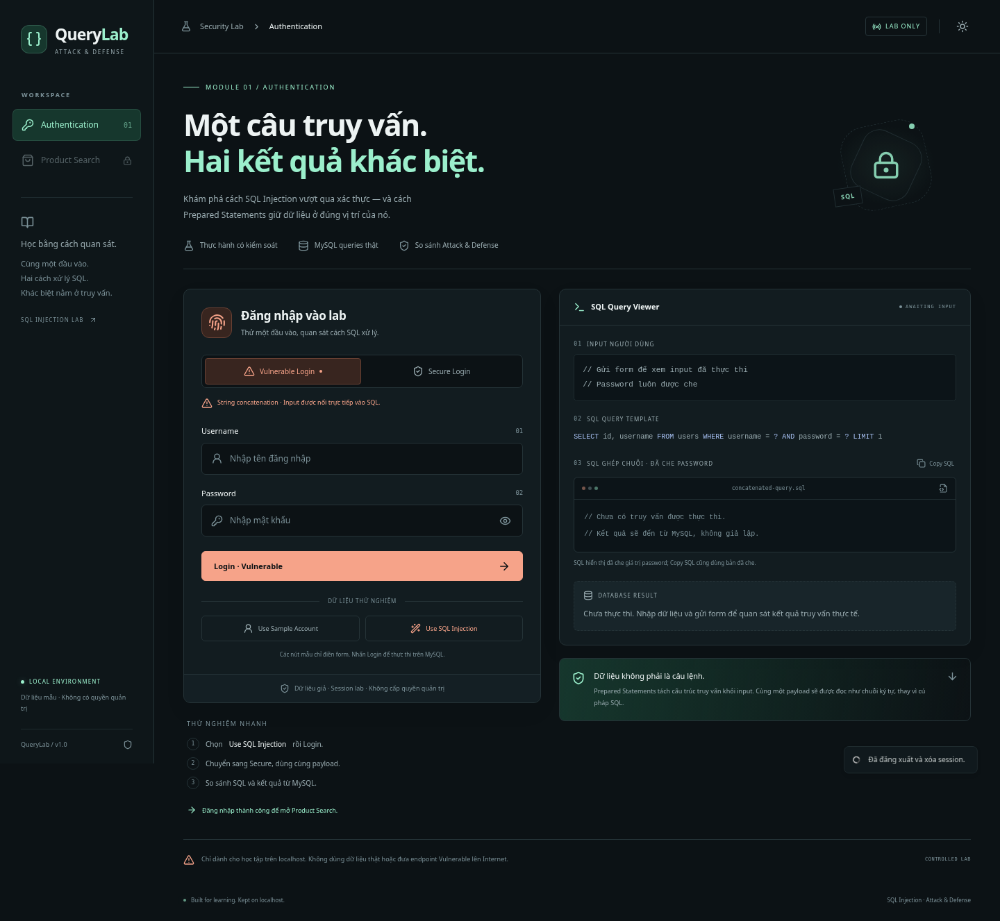

# QueryLab — Tấn công và phòng chống SQL Injection

Website phục vụ báo cáo giữa kỳ, so sánh **Vulnerable** (nối chuỗi SQL có chủ đích) và **Secure** (Prepared Statements của MySQL). Hai bài thực hành: vượt qua đăng nhập và làm lộ điện thoại đang ẩn. Mọi kết quả đều lấy từ truy vấn MySQL thật, không có mock database hoặc nhánh JavaScript tự cho payload thành công.

**Chỉ chạy trên localhost, dùng schema riêng và dữ liệu giả. Không public frontend, backend, tunnel hoặc reverse proxy lab ra Internet.** Tài khoản có role `admin` trong seed cũng không được cấp chức năng quản trị ứng dụng. Không nhập tài khoản thật vào lab.

## Xem trước giao diện

Ảnh chụp khi chạy kiểm thử với MySQL thật và dữ liệu mẫu, không phải website trực tuyến. Kết nối Aiven vẫn cần cấu hình riêng.



[Xem trang sản phẩm trên desktop](docs/screenshots/products-desktop-dark.png) · [Xem giao diện mobile — Light Mode](docs/screenshots/products-mobile-light.png)

## 1. Công nghệ và cấu trúc

- Node.js 24 LTS (tối thiểu 22.12), npm workspaces.
- React 19, Vite, JavaScript JSX, Tailwind CSS 4, React Router, Axios, Lucide React, React Hot Toast.
- Express 5, `mysql2/promise` connection pool, dotenv, cors, helmet, express-session.
- MySQL 8 trên Aiven, xác minh TLS và hostname với CA do Aiven cung cấp.
- Node test runner + Supertest, Vitest + Testing Library, Playwright với trình duyệt Chromium.

```text
DemoBMUD/
├── frontend/
│   ├── public/                 # Favicon
│   ├── src/
│   │   ├── api/                # Axios client, authApi, phoneApi
│   │   ├── components/
│   │   │   ├── common/         # Layout, tabs, theme, QueryViewer
│   │   │   ├── auth/           # LoginForm
│   │   │   └── phones/         # SearchBar, PhoneCard, PhoneGrid
│   │   ├── contexts/           # Session/auth state
│   │   ├── pages/              # LoginPage, ProductsPage
│   │   ├── routes/             # ProtectedRoute
│   │   └── test/               # Component tests
│   └── vite.config.js
├── backend/
│   ├── src/
│   │   ├── config/             # Đọc env, kiểm tra cấu hình, TLS, pool
│   │   ├── controllers/        # Secure/Vulnerable request handlers
│   │   ├── middlewares/        # Localhost, Origin, lab, auth, lỗi an toàn
│   │   ├── routes/             # API routes
│   │   ├── services/           # SQL, input validation, session
│   │   └── app.js
│   ├── scripts/init-db.js
│   ├── test/                   # Config, boundary, integration MySQL thật
│   ├── .env.example
│   └── server.js
├── database/                   # schema.sql, seed.sql
├── scripts/test-local-mysql.mjs # Fixture Docker MySQL thật, tự dọn sau test
├── tests/e2e/                  # Trình duyệt + backend + MySQL thật
├── package.json
├── package-lock.json
└── playwright.config.js
```

Ảnh điện thoại là minh họa SVG tạo trong giao diện, không tải ảnh hoặc font từ dịch vụ bên ngoài. Thông tin sản phẩm, số lượng và trạng thái đều lấy từ MySQL.

## 2. Cài dependencies

Chạy trong thư mục gốc repository:

```bash
nvm use                     # Nếu sử dụng nvm
npm ci
cp backend/.env.example backend/.env
node -e "console.log(require('node:crypto').randomBytes(48).toString('hex'))"
```

Dán giá trị ngẫu nhiên vừa tạo vào `SESSION_SECRET` trong **file local** `backend/.env`. Không commit `.env`, CA certificate hay khóa. Nếu home của môi trường cloud không ghi được, dùng `npm ci --cache /tmp/querylab-npm-cache`.

## 3. Cấu hình Aiven MySQL

Chưa có Aiven thì chưa thể chạy backend ứng dụng với database từ xa. Code không tự tạo kết nối giả; startup sẽ thất bại với thông báo rõ ràng. Frontend vẫn có thể chạy để kiểm tra trạng thái backend chưa sẵn sàng.

1. Tạo service **MySQL**, schema riêng cho lab, ví dụ `sql_injection_demo`. Không dùng schema đang có dữ liệu thật.
2. Trong Aiven Console, lấy hostname, **port thực tế** (có thể khác 3306) và CA certificate của service. Tải CA vào vị trí local được bảo vệ, ví dụ ngoài repository.
3. Dùng một tài khoản khởi tạo có quyền `CREATE`, `SELECT`, `INSERT`, `UPDATE` trên **schema lab riêng** để chạy schema và seed. Không dùng tài khoản này chạy ứng dụng.
4. Nhờ người quản lý service tạo tài khoản runtime, chỉ cấp `SELECT` trên `sql_injection_demo.users` và `sql_injection_demo.phones`. Không cấp quyền global, `FILE`, `PROCESS`, `GRANT OPTION`, `CREATE USER`, hay quyền trên schema khác. Dùng công cụ quản trị hoặc cơ chế phân quyền được Aiven hỗ trợ. Kiểm tra `SHOW GRANTS` trong phiên quản trị trước khi chạy.
5. Cho phép IP máy lab trong cấu hình mạng Aiven nếu service có IP allowlist. Luồng ứng dụng là Node localhost → Aiven MySQL qua TLS. Không mở API lab ra ngoài để khắc phục kết nối DB.
6. Điền các biến sau trong `backend/.env` bằng thông tin thật lấy từ Aiven:

```dotenv
DB_HOST=
DB_PORT=3306
DB_USER=
DB_PASSWORD=
DB_NAME=sql_injection_demo
DB_SSL_CA_PATH=
DB_SSL_MODE=required
PORT=5000
FRONTEND_URL=http://localhost:5173
SESSION_SECRET=
LAB_MODE=true
```

`DB_SSL_CA_PATH` nên là đường dẫn tuyệt đối tới CA PEM. TLS luôn xác minh certificate chain và hostname; không dùng `rejectUnauthorized: false`. Nếu môi trường cần cấp quyền egress, cho phép đúng hostname/port MySQL của service Aiven. Không gửi secret qua chat hay lưu trong README. `DB_SSL_MODE=disabled` **chỉ** được chấp nhận cho MySQL thực chạy trên loopback, phục vụ fixture kiểm thử; không dùng cho Aiven.

## 4. Khởi tạo schema và seed

Điền tạm thông tin **tài khoản khởi tạo riêng** vào `backend/.env`, kiểm tra lại DB_NAME là schema lab rồi chạy từ gốc:

```bash
DB_INIT_CONFIRM=lab-only npm run db:init
```

Script đọc `database/schema.sql` và `database/seed.sql`, thực thi **từng statement** qua TLS; không bật `multipleStatements`. Các file không DROP bảng hoặc CREATE DATABASE. Seed sử dụng ID cố định và cập nhật bản ghi mẫu khi chạy lại: chỉ chạy trên schema lab riêng. Chạy lại không nhân đôi 5 users/10 phones. Script in số bản ghi thực tế sau khi chạy.

Sau khi seed, **đổi DB_USER/DB_PASSWORD về tài khoản runtime chỉ SELECT**, rồi khởi động ứng dụng. Không để credential quản trị trong tiến trình backend. Khi không đủ quyền seed, không cấp thêm quyền quản trị cho runtime; dùng lại tài khoản khởi tạo riêng.

Bạn cũng có thể chạy các file bằng MySQL CLI với `--ssl-mode=VERIFY_IDENTITY`, `--ssl-ca` và `-p` để nhập mật khẩu qua prompt; chọn đúng schema lab cho cả hai file.

Tài khoản giả trong seed:

| Username | Password mẫu | Role trong dữ liệu |
|---|---|---|
| admin | admin123 | admin |
| manager | manager123 | user |
| demo | demo123 | user |
| minh | minh123 | user |
| linh | linh123 | user |

Mật khẩu plaintext chỉ phục vụ việc so sánh SQL trong schema mẫu. **Secure trong dự án nghĩa là chống SQL Injection**, không phải hệ thống xác thực production. Hệ thống thật phải dùng Argon2/bcrypt, rate limiting, session store bền vững và quy trình quản lý tài khoản phù hợp.

Seed gồm 10 điện thoại từ Apple, Samsung, Xiaomi, OPPO và Google Pixel: 6 `on`, 4 `off`. Giá và tồn kho đều giả lập cho bài lab, không phải thông tin bán hàng thực tế.

## 5. Khởi động

Từ gốc repository, chạy đồng thời hai tiến trình:

```bash
npm run dev
```

Hoặc chạy hai terminal riêng:

```bash
# Terminal 1 — backend
npm run dev:backend

# Terminal 2 — frontend
npm run dev:frontend
```

Backend bind cứng `127.0.0.1`, mặc định cổng **5000**; Vite bind `127.0.0.1`, cổng **5173**, `strictPort`. Trên máy local, mở origin `http://localhost:5173` đã cấu hình. Dùng nhất quán origin này để session cookie cùng hoạt động. Vite chuyển `/api` đến backend local; không cần sửa URL API trong source.

Kiểm tra nội bộ backend:

```bash
curl --fail http://127.0.0.1:5000/api/health
```

Chỉ báo `database: connected` sau khi MySQL thực thi thành công `SELECT 1`. Nếu thiếu cấu hình Aiven/secret, server không mở cổng và trả mã thoát khác 0. Nếu database ngắt sau khi server đã chạy, API trả lỗi 503 chung, không lộ host, password hoặc stack trace.

Nếu đổi `PORT`, đặt `API_PROXY_TARGET` tương ứng khi chạy frontend, ví dụ dùng loopback và cổng vừa chọn. Nếu đổi cổng frontend, cần đồng bộ `FRONTEND_URL` và cấu hình Vite. Không thay host bind thành `0.0.0.0`, không bật `allowedHosts: true` hoặc CORS wildcard.

```bash
npm run build  # Kiểm tra và tạo frontend/dist, không khởi chạy/public lab
```

`vite preview` chỉ xem bundle frontend; không thay thế quy trình khởi động API ở trên. Không dùng hosting public cho bản Vulnerable.

## 6. Trình diễn Login

1. Vào `/login`, chọn **Vulnerable Login**.
2. Chọn **Use Sample Account** rồi **Login**: đăng nhập bằng `admin / admin123` thành công từ database thật. Secure Login cũng dùng chính tài khoản này.
3. Logout, chọn **Use SQL Injection**. Nút chỉ điền `username = "admin' -- "`, `password = "anything"`; nhấn Login mới gọi API.
4. Vulnerable nối trực tiếp input: phần `-- ` (có dấu cách cuối) biến điều kiện mật khẩu thành comment trong MySQL. Kết quả truy vấn thực quyết định có đăng nhập hay không.
5. Khi truy vấn Vulnerable trả một user, backend kiểm tra lại **cùng input** bằng Prepared Statement để xác định nguồn gốc: nếu không khớp thì tạo **Injection Demo Session**, không cấp role hoặc khả năng quản trị.
6. Logout, chuyển **Secure Login**, dùng **chính xác cùng payload** rồi Login. Prepared Statement trả 0 user và API báo sai thông tin đăng nhập.

Sau đăng nhập, chuyển đến `/products`. Nhấn **Xem SQL đăng nhập** để xem lại truy vấn thành công, vì route Login đã điều hướng. Password luôn được che trong trace/API và bản Copy SQL. Truy vấn hiển thị khi login là bản đã che, không phải chuỗi chứa mật khẩu nguyên gốc.

## 7. Trình diễn Search

1. Trang sản phẩm tự truy vấn danh sách mặc định: chỉ 6 sản phẩm `on`.
2. **Use Sample Search** điền `iPhone`, rồi **Search**: cả hai chế độ trả 2 iPhone công khai phù hợp.
3. **Use SQL Injection** điền payload chỉ đọc `"' OR 1=1 -- "`, rồi Search trên Vulnerable.
4. Điều kiện được biến đổi thành dạng `status = 'on' AND name LIKE '%' OR 1=1 -- ...`. `OR 1=1` khiến cả 10 dòng phù hợp; 4 dòng `off` có badge **HIDDEN – EXPOSED BY SQL INJECTION**.
5. Thông báo khai thác thành công chỉ xuất hiện nếu API thực sự trả sản phẩm `off`, không dựa vào thao tác chọn nút mẫu.
6. Chuyển **Secure Search**: kết quả cũ được xóa và truy vấn danh sách công khai lại. Dùng cùng payload: nó trở thành giá trị của parameter LIKE; không làm thay đổi cấu trúc SQL, không trả sản phẩm OFF (seed chuẩn cho 0 kết quả).

Query Viewer hiển thị input, template, chuỗi nối có highlight input hoặc statement + parameters, số dòng thực tế và giải thích. Kết quả trống/lỗi không bị thay bằng dữ liệu cứng. Wildcard `%`/`_` vẫn có nghĩa trong LIKE ở Secure nhưng luôn bị ràng buộc bởi `status = 'on'`.

## 8. API và biện pháp giới hạn lab

| Method | Endpoint | Session |
|---|---|---|
| GET | `/api/health` | Không; thực thi SELECT 1 |
| POST | `/api/vulnerable/login` | Không; cần LAB_MODE=true |
| POST | `/api/secure/login` | Không |
| GET | `/api/auth/me` | Có |
| POST | `/api/auth/logout` | Xóa session nếu có |
| GET | `/api/vulnerable/phones/search?q=...` | Có; cần LAB_MODE=true |
| GET | `/api/secure/phones/search?q=...` | Có |

- Mọi API đều yêu cầu kết nối trực tiếp từ loopback, Host localhost/loopback, không tin forwarded headers.
- POST phải có Origin hợp lệ. CORS chỉ origin frontend cấu hình; không cho website ngoài gọi lab.
- `LAB_MODE=false` trả 403 cho toàn bộ router Vulnerable; không thay đổi dữ liệu hoặc tắt Secure.
- Cookie HttpOnly, SameSite=Strict, 1 giờ, session ID tái tạo sau đăng nhập, logout hủy session server. HTTP cookie chỉ dùng cho localhost; không dùng cookie production theo cấu hình lab.
- Session MemoryStore dành cho một tiến trình lab; khởi động lại backend sẽ xóa phiên. Frontend kiểm tra `/auth/me` và chuyển về Login khi session hết hạn.
- Các role trong database chỉ là dữ liệu minh họa, không có API quản trị. Hai chế độ có thể truy cập cửa hàng để so sánh cùng dữ liệu.
- API chỉ SELECT các cột cần thiết, không trả password/role. Không log credential, SQL nhạy cảm hoặc thông tin kết nối. Lỗi SQL trả thông báo chung.
- Các truy vấn Secure dùng `execute(statement, params)`. Vulnerable giữ lỗi có chủ đích trong `queryService.js`. Không copy mã Vulnerable sang ứng dụng thật.
- `multipleStatements=false`, input giới hạn độ dài và loại dữ liệu; payload mẫu chỉ đọc, không có payload phá hủy.
- Middleware localhost là lớp bảo vệ thêm, không thay thế việc không public lab. Người dùng local có chủ đích vẫn có thể gửi request; đây không phải cơ chế cô lập nhiều người dùng.

SQL Injection xảy ra khi input được phân tích như cú pháp trong một câu SQL ghép chuỗi. Prepared Statements gửi cấu trúc SQL và tham số riêng, vì vậy các ký tự SQL trong parameter chỉ là dữ liệu. Việc lọc một vài từ khóa hoặc kiểm tra payload ở frontend không phải cách khắc phục trong dự án này.

## 9. Kiểm thử

### Không cần database

```bash
npm test
npm run build
```

Bao gồm kiểm tra cấu hình thiếu, policy TLS, Host/Origin/proxy, LAB_MODE, auth guard, lỗi không lộ nội bộ, TC11 (badge ON/OFF), TC13 (route guard). Component tests có fixture props để kiểm tra UI, **không** thay thế truy vấn database trong ứng dụng hay integration/E2E.

### Tự chạy toàn bộ bằng MySQL 8.4 thực trên Docker

Cần Docker daemon và Chromium. Nếu chưa có Chromium hệ thống:

```bash
npx playwright install chromium
```

Sau đó:

```bash
npm run test:lab
```

Script tải image MySQL 8.4 đã pin digest, tạo container **tạm thời**, publish MySQL trên cổng loopback ngẫu nhiên, sinh mật khẩu ngẫu nhiên trong bộ nhớ, chạy schema và seed hai lần để kiểm tra lặp lại, rồi tạo runtime user chỉ SELECT trên hai bảng. Sau đó chạy unit/component, build, integration và E2E. Container được dọn trong `finally` cả khi test thất bại; nếu bị kill cưỡng bức, kiểm tra và xóa container tên `querylab-test-*` do lần chạy đó tạo. Không xóa container khác.

Script **không** dùng hoặc thay đổi cấu hình/schema Aiven của bạn; không tạo `.env` chứa kết nối giả. Fixture Docker xác thực logic MySQL, không chứng minh TLS/mạng/quyền trên Aiven. Nếu máy có `/usr/bin/chromium` script tự dùng nó; có thể đặt `PLAYWRIGHT_CHROMIUM_EXECUTABLE_PATH` tới Chromium khác.

### Chạy riêng với schema kiểm thử Aiven thật

Tạo **schema kiểm thử riêng**, nạp seed bằng tài khoản initializer rồi chuyển về runtime chỉ SELECT như hướng dẫn. `backend/.env` phải trỏ tới schema test này. Không dùng service/schema có dữ liệu thật.

```bash
TEST_DB_CONFIRM=lab-only npm run test:integration
npm run test:e2e
```

Hai lệnh không chạy mock, không seed tự động, không skip khi thiếu database. Test yêu cầu đúng 5 users, 6 ON, 4 OFF và sẽ thất bại nếu tài khoản runtime được cấp UPDATE. Một ca UPDATE vô hại (`WHERE id = -1`) chỉ kiểm tra quyền, không sửa bản ghi. E2E tự chạy backend/frontend ở cổng 5000/5173; dừng các tiến trình dev của bạn trước để tránh xung đột. Khi dùng Chromium hệ thống, đặt `PLAYWRIGHT_CHROMIUM_EXECUTABLE_PATH` nếu cần.

### Ánh xạ ca kiểm thử bắt buộc

| ID | Trường hợp | Nơi xác minh |
|---|---|---|
| TC01 | Vulnerable, tài khoản đúng | MySQL integration |
| TC02 | Secure, tài khoản đúng | MySQL integration + browser |
| TC03 | Vulnerable, sai mật khẩu | MySQL integration |
| TC04 | Secure, sai mật khẩu | MySQL integration |
| TC05 | Vulnerable, injection bypass thật | MySQL integration + browser |
| TC06 | Secure, cùng payload thất bại | MySQL integration + browser |
| TC07 | Vulnerable tìm iPhone chỉ ON | MySQL integration |
| TC08 | Secure tìm iPhone chỉ ON | MySQL integration + browser |
| TC09 | Vulnerable trả 10, gồm 4 OFF | MySQL integration + browser |
| TC10 | Secure không lộ OFF | MySQL integration + browser |
| TC11 | OFF có badge HIDDEN | Component + browser với dữ liệu MySQL |
| TC12 | Logout hủy cookie/session cũ | MySQL integration + browser |
| TC13 | Chưa đăng nhập chuyển Login | Component + browser |
| TC14 | Thiếu Aiven báo lỗi rõ ràng | Config tests + startup fail-fast |

Browser tests còn kiểm tra reload giữ session, đổi chế độ không tái sử dụng kết quả, mobile không tràn ngang, Light/Dark Mode và lỗi JavaScript. Screenshot sinh vào `test-results/` (đã ignore); trace chỉ giữ khi fail. Không commit trace thật có thể chứa input/session.

## 10. Tình trạng kết nối và giới hạn

Repository không bao gồm credential Aiven hoặc CA certificate. **Chưa xác thực kết nối Aiven** cho tới khi bạn cấu hình service thật và chạy health/integration ở trên. Kiểm thử MySQL Docker và kiểm thử Aiven là hai kết quả riêng; không gọi Docker fixture là Aiven.

Kết quả đã chạy trong workspace, số lượng test và ánh xạ TC01–TC14 được ghi ở [docs/verification.md](docs/verification.md).

Trong môi trường cloud không hỗ trợ browser localhost, không tạo public preview/tunnel để trình diễn. Chạy các local requests và test trong môi trường đó; demo trực quan trên máy local được kiểm soát.
